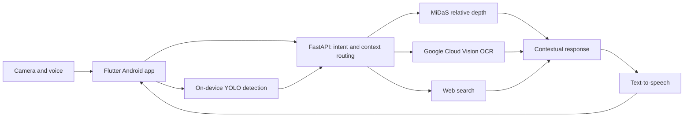

# Farida Hamid

### AI Engineer & Data Scientist

Computer Vision · Agentic AI · Retrieval Systems · Applied Machine Learning

[LinkedIn](https://www.linkedin.com/in/farida-hamid-6740b8253/) · [Email](mailto:faridahamid2004@gmail.com)

---

## About me

I am an AI Engineer and Data Scientist based in Cairo, Egypt, and a Data Science graduate from Cairo University. I work across model development, data analysis, and application engineering, connecting machine learning with interfaces and services that people can use.

My projects include a voice-first vision assistant for blind and visually impaired users, multi-organization knowledge assistants, agentic retrieval across structured and unstructured data, and machine learning for educational and industrial applications. My experience includes a Data Science and AI internship at Fixed Solutions and technical training in NLP, Big Data, cloud computing, and AI.

Alongside technical work, I contribute to the Competition Team at NASA Space Apps Cairo, supporting hackathon planning, participant engagement, and event delivery.

## Academic achievements & recognition

| Achievement | Details |
| --- | --- |
| **Graduation project: 200/200 · A+** | Lumin, an AI-powered accessibility assistant developed as a team graduation project at Cairo University |
| **Ranked 5th in the Data Science Department** | B.Sc. in Data Science, Cairo University · GPA **3.67 / 4.0** |
| **Big Data program recognition** | Recognized as one of the top students in the Big Data Associate Egyptian Talents Academy program; celebrated at the first ETA graduation ceremony, attended by **Dr. Amr Talaat, Minister of Communications and Information Technology** |
| **NASA Space Apps Cairo: Local Winner & Global Nominee** | VEGA, an interactive exoplanet education platform developed with my team |

---

## Featured projects

### Lumin — AI-Powered Vision & Voice Assistant

**Cairo University graduation project · Team project · Awarded 200/200 and A+**

  

Lumin helps blind and visually impaired users access visual information through spoken interaction. It brings object detection, relative depth estimation, contextual OCR, and conversational web search into a Flutter Android application connected to a FastAPI backend.

Rather than treating each capability as a separate tool, the application routes voice commands and follow-up questions to the relevant service. For example, a user can scan printed text, ask a question about it, and receive a spoken response grounded in the retained OCR context or supplemented by web search.

**Core capabilities**

- **Scene understanding:** On-device YOLO object detection, combining general-purpose recognition with a custom model for indoor objects commonly found in Egyptian homes.
- **Relative proximity:** MiDaS depth estimation adds relative descriptions such as close or far to detected objects.
- **Contextual text reading:** Google Cloud Vision extracts printed text; language-model processing supports interpretation and follow-up questions.
- **Voice interaction:** Wake-word activation, speech transcription, intent routing, and text-to-speech, with prompts designed around Egyptian Arabic.
- **Conversational search:** Web-assisted responses with citations when the question requires information beyond camera or OCR context.

**Actual application screenshots**

<table>
  <tr>
    <td align="center"> Indoor object detection and proximity</td>
    <td align="center"> Contextual OCR responses</td>
    <td align="center"> Voice-driven web search</td>
  </tr>
</table>

**Architecture**

**Engineering details:** The project includes a custom 26-class indoor dataset, a YOLO fine-tuning notebook, TensorFlow Lite model exports, backend inference services, and an OCR context router. Flutter handles camera input and the mobile experience; the Python backend connects perception context, speech, OCR, and reasoning services. Relative depth provides proximity cues rather than calibrated distances.

**My contribution:** End-to-end system architecture, connecting the Flutter interface with backend inference services and AI capabilities, as part of the graduation-project team.

**Technologies:** Python · Flutter/Dart · FastAPI · YOLO · TensorFlow Lite · MiDaS · Google Cloud Vision · Voice and language-model APIs

[Source code](https://github.com/faridahamid/Lumin) · [Video demonstration](https://youtu.be/bFaR9sQwEBA) · [Graduation report](https://github.com/faridahamid/Lumin/blob/main/Document%26poster/Graduation%20Project%20Report.pdf)

---

### Agentic RAG — MCP & Hybrid Knowledge Retrieval

**Agent orchestration · Structured, semantic, and graph retrieval**

An extension of the multi-organization RAG platform that exposes retrieval actions as Model Context Protocol tools. An LLM-driven client selects the appropriate tools according to the question, combining different sources of organizational knowledge.

- **SQL retrieval:** PostgreSQL answers structured lookups, counts, and lists through named, approved queries.
- **Vector retrieval:** Semantic search retrieves relevant passages from organization-specific documents.
- **Graph enrichment:** Neo4j adds entity and relationship context to grounded answers.
- **Answer validation:** A separate validator reviews source grounding, completeness, and tenant safety.
- **Visual explanations:** Cytoscape.js renders a fresh, organization-scoped knowledge graph after the response; empty results do not reuse a previous graph.

  

The architecture maintains organization scoping across SQL, vector, and graph layers. The agent can choose structured retrieval for factual tables, semantic retrieval for document questions, and graph traversal when relationships add useful context.

**Technologies:** MCP · PostgreSQL · pgvector · Neo4j · Cytoscape.js · LLM orchestration

[Source code and architecture](https://github.com/faridahamid/Agentic-ChatBot-RAG)

---

### Multi-Organization RAG Chatbot Platform

**Document-grounded answers · Multilingual retrieval · Role-based access**

A full-stack knowledge assistant with separate knowledge bases for each organization. Administrators manage documents and users; users ask questions through text or voice, review conversation history, and provide response feedback.

  

**Implementation**

- Processes PDF, DOCX, TXT, and CSV documents through extraction, chunking, and embedding.
- Uses multilingual SentenceTransformers embeddings and pgvector for cross-lingual retrieval, including Arabic questions over English documents.
- Combines retrieved document context with Gemini response generation through the backend.
- Supports administrator and user roles, organization-scoped access, persistent chat history, and response feedback.
- Integrates Whisper-based speech-to-text and fallback responses when the available documents do not support an answer.

**Technologies:** Python · FastAPI · LangChain · PostgreSQL · pgvector · SentenceTransformers · Gemini · Whisper

[Source code](https://github.com/faridahamid/ChatBot-RAG) · [Full platform demonstration](https://youtu.be/q7oVBK4CPss)

---

### VEGA — Interactive Exoplanet Exploration

**NASA Space Apps Cairo Local Winner · Global Nominee · Team project**

VEGA combines machine learning, NASA exoplanet data, and interactive educational content to introduce different age groups to planets beyond our solar system.

  

- **Children:** Personalized stories generated with Gemini, audio narration, and interactive games.
- **High-school students:** An educational e-book, exoplanet visualizations, habitability predictions, podcasts, and quizzes.
- **Adults:** Detailed articles, comparative data visualizations, and interactive simulations.
- **Data and modeling:** NASA's Planetary System Composite Data supports exoplanet comparisons and clustering-based habitability predictions.

The project connects data analysis and machine learning with an accessible educational experience. It was developed collaboratively and recognized as a local winner in Cairo, with a global nomination in NASA Space Apps.

**Technologies and methods:** Machine learning · Clustering · NASA exoplanet data · Gemini API · Data visualization · Web development

[Source code](https://github.com/faridahamid/Vega) · [Explore VEGA](https://vega-final.vercel.app/)

---

### RoboFault — UR3 Robot Fault Analysis

**Industrial telemetry · Time-series analysis · Feature engineering**

An analysis of Universal Robots UR3 sensor logs to investigate protective stops and grip loss events. The dataset contains joint currents, speeds, temperatures, and tool-current signals, with faults representing approximately 3–4% of observations.

- Applied per-cycle interpolation and examined fault versus normal operation.
- Engineered load, sudden-change, current-asymmetry, and thermal-lag features.
- Studied correlations, density overlap, statistical differences, and fault-event durations.
- Evaluated threshold behavior on Joint 0, showing how overlapping distributions and class imbalance limit precision.

  

[Analysis and source code](https://github.com/faridahamid/Robo-Fault)

---

## Professional experience

### Data Science & AI Intern — Fixed Solutions

**July–October 2025**

My internship progressed across three areas:

1. **Full-stack Data Science:** Built applications including a multi-organization chatbot and AI agents using n8n.
2. **Advanced Data Science & Analytics:** Analyzed complex datasets for customer segmentation, behavior prediction, optimization, and fault detection in robotic systems.
3. **Agentic AI:** Contributed to an agent-based RAG chatbot combining structured, unstructured, and graph data for grounded and validated responses.

### Summer Intern — Commercial International Bank

**July–August 2024**

Explored data literacy, cybersecurity, financial literacy, and financial inclusion. Studied how digitalization and fintech are influencing banking services and financial accessibility.

## Technical training & professional development

### Big Data Associate — Egyptian Talents Academy / NTI

**August–September 2024 · Huawei ETA program**

Completed Big Data training at the National Telecommunication Institute in collaboration with the Egyptian Talents Academy. The program focused on the Hadoop ecosystem and the integration of distributed storage, processing, and streaming technologies.

**Topics and tools:** HDFS · YARN · ZooKeeper · Hive · HBase · Spark · Flink · Flume · Kafka · Elasticsearch

**Recognition:** I was recognized as one of the top students in the Big Data Associate ETA program. This achievement was celebrated at the first graduation ceremony of ETA graduates, attended by **Dr. Amr Talaat, Minister of Communications and Information Technology**.

### Natural Language Processing — NTI

**July–August 2025**

Practical training in text processing, embeddings, and sentiment analysis, with sessions connecting technical work to freelancing and professional development.

### AWS Cloud — NTI

**August–September 2024**

Studied cloud computing, virtualization, software-defined storage, and network virtualization through VMware-based sessions. Completed AWS Cloud Practitioner and Cloud Architecture courses covering cloud deployment and management.

### Artificial Intelligence / HCIA — Huawei & NTI

**July–August 2023 · 120 hours**

Training in the mathematical and statistical foundations of AI, machine learning, and deep learning algorithms.

### Additional programs & courses

| Program | Provider | Date |
| --- | --- | --- |
| Data Science Program Internship | ALX | May 2025 |
| Associate Data Scientist in Python Track | DataCamp | May 2025 |
| Machine Learning Specialization | Stanford University & DeepLearning.AI / Coursera | February 2024 |
| Python for Everybody Specialization | University of Michigan | January 2024 |
| Business Model Innovation | Egypt Innovate | December 2023 |

## Community & volunteering

### Competition Team Volunteer — NASA Space Apps Cairo

**August 2026–Present**

Contributing to the organization of NASA Space Apps Cairo, supporting the planning and delivery of the global hackathon.

- Coordinate pre-hackathon activities and workshops.
- Support participant communications and engagement.
- Contribute to event content and resources.
- Help improve the overall participant experience.

My involvement has progressed from participating with the local-winning, globally nominated VEGA team to supporting the competition as a volunteer.

### Additional activities

- **Machine Learning Community member — Google Developer Student Club:** 2023–2024.
- **Mathematics Assistant / Team Leader:** 2022–2023.

## Education

**B.Sc. in Data Science — Cairo University**  
Faculty of Computer Science & Artificial Intelligence  
September 2022–July 2026

- **GPA:** 3.67 / 4.0
- **Department rank:** 5th in the Data Science Department
- **Graduation project:** Lumin — **200/200, A+**

## Technical skills

| Area | Technologies & methods |
| --- | --- |
| AI & Machine Learning | Computer vision, NLP, deep learning, agentic AI, retrieval-augmented generation, model evaluation |
| ML Frameworks | TensorFlow, PyTorch, YOLO, SentenceTransformers |
| AI Application Development | FastAPI, LangChain, MCP, Flutter, n8n |
| Data & Retrieval | PostgreSQL, pgvector, Neo4j, SQL, Spark, PySpark, Kafka |
| Cloud | AWS Cloud, Google Cloud Vision |
| Programming | Python, SQL, C++, C#, Java |
| Computer Science | Data structures, algorithms, problem solving |

## Contact

[LinkedIn](https://www.linkedin.com/in/farida-hamid-6740b8253/) · [faridahamid2004@gmail.com](mailto:faridahamid2004@gmail.com)
